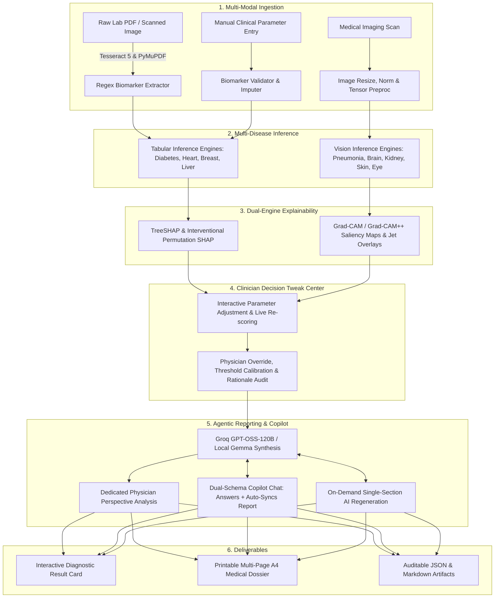

<div align="center">
  <h1>MedSynapse: Agentic LLM Orchestration of Multi-Disease Diagnostic Models 🏥</h1>
  <h3>A Unified Framework for Explainable, Confidence-Aware, and Guideline-Grounded Medical Reporting</h3>

  <p><i>"Bridging Fragmented Single-Disease Classifiers into an Autonomous, Multi-Modal Agentic Diagnostic System with Fused Multi-Method Explainability (XAI) and Clinician-in-the-Loop Oversight"</i></p>

  <div>
    
    
    
    
    
    
    
    
  </div>
</div>

---

## 📖 Research Abstract & Clinical Motivation

Modern healthcare AI systems predominantly operate as isolated, single-disease classifiers that output raw, uncalibrated probability scores without clinically interpretable context. In real hospital workflows, patients rarely present with an isolated condition; rather, clinical presentations involve interconnected organ systems, multi-analyte lab panels, and multi-spectral radiologic scans. Physicians cannot ethically or legally act on uninterpretable "black-box" scores lacking physiological justification, lesion localization, or alignment with established clinical practice guidelines.

**MedSynapse** addresses this foundational challenge through an **autonomous, multi-modal agentic diagnostic framework** that orchestrates **nine specialized machine learning and deep learning backbones**—spanning metabolic, cardiovascular, pulmonary, neuro-oncological, oncological, hepatic, nephrological, dermatological, and ophthalmic domains—under a central coordinating Large Language Model (LLM) agent (`openai/gpt-oss-120b` / local Ollama backbones) with real-time clinician-in-the-loop oversight.

The system ingests **multi-modal patient inputs** (clinical text, PDF/image lab panels via Tesseract 5 & PyMuPDF OCR, digital radiography, MRI, CT, and dermoscopy), dynamically routes queries to the validated disease backbones, and enriches raw model predictions through **Dual-Engine Explainability (XAI)**—combining game-theoretic SHAP (TreeSHAP & Interventional Permutation SHAP) for numerical lab biomarkers with deep Grad-CAM / Grad-CAM++ neural activation heatmaps for radiologic imaging. Findings are synthesized into calibrated, guideline-grounded clinical summaries featuring dedicated **Physician Perspective Analysis**, real-time **Copilot Chat with Auto-Report Synchronization**, and on-demand **Per-Section AI Regeneration**.

---

## 🏗️ Master System Architecture

```
                  ┌────────────────────────────────────────────────────────┐
                  │          1. Multi-Modal Patient Ingestion Layer        │
                  │   • Lab Reports (PDF / Image OCR: Tesseract 5 & PyMuPDF│
                  │   • Digital Scans (Chest X-Ray, Brain MRI, CT, Fundus) │
                  │   • Clinical Biomarkers & Hemodynamics (Numeric Panels)│
                  └───────────────────────────┬────────────────────────────┘
                                              │
                                              ▼
                  ┌────────────────────────────────────────────────────────┐
                  │    2. LLM Agent: Intent Recognition & Modality Triage  │
                  │   • Entity Extraction (NER) • Parameter Normalization  │
                  │   • Dynamic Routing to Tabular vs. Vision Backbones    │
                  └─────────┬──────────────────────────────────┬───────────┘
                            │                                  │
           Tabular Clinical Biomarkers                Radiologic / Photographic Imaging
                            │                                  │
                            ▼                                  ▼
      ┌───────────────────────────────────┐      ┌───────────────────────────────────┐
      │   3A. Tabular Diagnostic Backbones│      │    3B. Vision Diagnostic Backbones│
      │  • M1: Diabetes (Soft-Voting Ens.)│      │  • M3: Pneumonia (Xception CNN)   │
      │  • M2: Heart Disease (Random For.)│      │  • M4: Brain Tumor (Xception MRI) │
      │  • M5: Breast Cancer (PCA + LR/Ens│      │  • M7: Kidney CT (EfficientNet/U-N│
      │  • M6: Liver Disease (ILPD Bench.)│      │  • M8: Skin Lesion (4-Block CNN)  │
      │                                   │      │  • M9: Retinal Eye (ResNet-18)    │
      └─────────────────┬─────────────────┘      └─────────────────┬─────────────────┘
                        │                                          │
                        ▼                                          ▼
      ┌───────────────────────────────────┐      ┌───────────────────────────────────┐
      │       4A. Tabular XAI Engine      │      │        4B. Vision XAI Engine      │
      │  • Polynomial TreeSHAP O(TLD²)    │      │  • Deep Grad-CAM & Grad-CAM++     │
      │  • Interventional Permutation SHAP│      │  • Dynamic Convolutional Hooks    │
      │  • Baseline E[f(x)] & Attributions│      │  • Jet Heatmap & Alpha Overlays   │
      └─────────────────┬─────────────────┘      └─────────────────┬─────────────────┘
                        │                                          │
                        └─────────────────────┬────────────────────┘
                                              │
                                              ▼
                  ┌────────────────────────────────────────────────────────┐
                  │   5. Clinician Decision Tweak Center & Audit Trail     │
                  │   • Physician Identity & License Logging               │
                  │   • Diagnostic Overrides & Risk Threshold Calibration  │
                  │   • Biomarker Rationales & Custom Actionable Protocols │
                  │   • Interactive In-Place Parameter Re-analysis Center  │
                  └───────────────────────────┬────────────────────────────┘
                                              │
                                              ▼
                  ┌────────────────────────────────────────────────────────┐
                  │   6. Agentic Synthesis, Copilot Chat & Section Regen   │
                  │   • Groq GPT-OSS-120B / Local Gemma LLM Orchestration  │
                  │   • Dedicated "Physician Perspective Analysis" Section │
                  │   • Real-Time Copilot Chat with Live Report Sync       │
                  │   • On-Demand Single-Section AI Regeneration           │
                  │   • Zero-Hallucination & Unit Normalization Validator  │
                  └───────────────────────────┬────────────────────────────┘
                                              │
                                              ▼
                  ┌────────────────────────────────────────────────────────┐
                  │   7. Calibrated Clinical Deliverable & Multi-Page PDF  │
                  │   • Multi-Page Printable Diagnostic Report (A4 Sheet)  │
                  │   • JSON / Markdown Export & Full Verification Audit   │
                  └────────────────────────────────────────────────────────┘
```

---

## ⚡ Active Web Application & Diagnostic Pipeline



### Technology Stack
| Layer | Implementation & Frameworks |
|---|---|
| **Frontend Framework** | React 18, Vite, Tailwind CSS, Lucide React, Custom Responsive Components |
| **Landing & Navigation** | `MedSynapseLandingExperience`, Floating `ProcessTrackerBar` with dynamic level audit flyout, `ModuleTopBar` |
| **Interactive Decision Center** | `ClinicianDecisionTweakCenter`, `DiagnosticResultCard` live parameter re-analysis, `ClinicalReportChat` |
| **API & Backend** | FastAPI, Pydantic v2 Schema Validation, Uvicorn ASGI |
| **Document Processing & OCR**| Tesseract OCR 5 Engine, PyMuPDF (fitz), Regex Parameter Normalizer |
| **Classical ML & Ensembles** | scikit-learn, XGBoost, LightGBM, NumPy, Pandas |
| **Deep Learning Backbones** | TensorFlow 2.x / Keras 3, PyTorch 2.x, Torchvision, TorchScript |
| **Explainable AI (XAI)** | TreeSHAP, Permutation SHAP, Keras Grad-CAM, PyTorch Gradient Hooks, NumPy Jet Colormap Blending |
| **LLM Agent & Copilot** | Groq API (`openai/gpt-oss-120b`, fallback `openai/gpt-oss-20b`), Local Ollama (Gemma-2-9B) |
| **Document Export Engine** | `printReportDocument` pure JS/CSS print engine, JSON/Markdown serializers |
| **Persistence & Cache** | SQLite Local Feature Store & In-Memory Assessment Registry |
| **Automated Testing** | Pytest (25 comprehensive unit & E2E integration test suites) |

### Key API Endpoints
| Endpoint | Method | Description |
|---|---|---|
| `/api/health` | `GET` | Reports system status, active model artifacts, and environment health |
| `/api/sample-reports` | `GET` | Returns sample clinical text reports across multiple disease categories |
| `/api/ocr/parse-report` | `POST` | Ingests PDF or image documents and extracts normalized clinical biomarker dictionaries |
| `/api/predict/diabetes` | `POST` | Executes diabetes risk evaluation with voting ensemble and SHAP attributions |
| `/api/predict/heart` | `POST` | Executes coronary heart disease risk evaluation with Random Forest and TreeSHAP |
| `/api/predict/breast` | `POST` | Executes breast cancer malignancy screening with PCA + Logistic Regression / Ensemble |
| `/api/predict/liver` | `POST` | Executes hepatic liver disease screening with Random Forest and TreeSHAP |
| `/api/predict/xray` | `POST` | Evaluates pediatric chest radiograph for pneumonia with Grad-CAM saliency overlay |
| `/api/predict/brain-tumor` | `POST` | Classifies cranial MRI into 4 tumor categories with Grad-CAM heatmap localization |
| `/api/predict/kidney-stone` | `POST` | Classifies abdominal CT slices into 4 kidney pathology classes with Grad-CAM |
| `/api/predict/skin-cancer` | `POST` | Classifies dermoscopy images into 7 HAM10000 skin lesions with Grad-CAM |
| `/api/predict/eye-disease` | `POST` | Evaluates retinal fundus images across ocular pathologies with PyTorch Grad-CAM |
| `/api/reports/generate-direct` | `POST` | Synthesizes an end-to-end clinical LLM report from predictions, tweaks, and chat history |
| `/api/reports/regenerate-section`| `POST` | **Regenerates a specific report section on demand** using full context and clinician prompts |
| `/api/reports/llm-chat` | `POST` | **Dual-schema interactive copilot chat**: returns assistant reply and auto-updated merged report |
| `/api/model-runs/{id}/review` | `POST` | Records clinician approval, decision overrides, and audit rationales |
| `/api/model-runs/{id}/final-report`| `POST` | Builds validated final report package with doctor verification and Groq synthesis |

---

## 📊 Empirical Diagnostic Performance Summary

All 9 diagnostic backbones were trained, cross-validated, and benchmarked on held-out test partitions of peer-reviewed clinical cohorts:

| Module ID | Diagnostic Domain | Clinical Target | Architecture / Algorithm | Test Accuracy | Precision | Recall / Sens. | F1-Score | AUC-ROC | Cohort & Size | Documentation |
| :---: | :--- | :--- | :--- | :---: | :---: | :---: | :---: | :---: | :--- | :--- |
| **M1** | **Metabolic** | Type-2 Diabetes Mellitus | Soft-Voting Ensemble (RF+GB+ET+LR) | **74.68%** | 0.75 | 0.75 | **0.74** | **0.82** | NIDDK Pima Indian (768 records) | [01_diabetes_prediction.md](docs/01_diabetes_prediction.md) |
| **M2** | **Cardiology** | Coronary Heart Disease | Random Forest Ensemble (100 Trees) | **98.54%** | 0.99 | 0.99 | **0.99** | **0.99** | Cleveland Clinic Foundation (1,025 cohort) | [02_heart_disease_prediction.md](docs/02_heart_disease_prediction.md) |
| **M3** | **Pulmonology** | Pediatric Pneumonia | Xception Deep Transfer Network | **83.01%** | 0.84 | 0.83 | **0.83** | **0.91** | Guangzhou Women's Center (5,856 X-Rays) | [03_chest_xray_pneumonia_prediction.md](docs/03_chest_xray_pneumonia_prediction.md) |
| **M4** | **Neuro-Oncology** | Cranial Brain Tumor (4-Class) | Xception Deep Transfer Network | **95.25%** | 0.96 | 0.95 | **0.95** | **0.98** | Nickparvar Multi-Center (7,023 MRIs) | [04_brain_tumor_prediction.md](docs/04_brain_tumor_prediction.md) |
| **M5** | **Oncology** | Breast Cancer Malignancy | PCA (10 Comp) + Tuned LR / Ensemble| **96.49%** | 0.97 | 0.96 | **0.96** | **0.99** | Wisconsin WDBC FNA (569 biopsies) | [05_breast_cancer_prediction.md](docs/05_breast_cancer_prediction.md) |
| **M6** | **Hepatology** | Hepatic Liver Disease | Random Forest / GBDT / XGBoost | **79.49%** | 0.80 | 0.79 | **0.79** | **0.84** | Andhra Pradesh ILPD (583 records) | [06_liver_disease_prediction.md](docs/06_liver_disease_prediction.md) |
| **M7** | **Nephrology** | Kidney Pathology (4-Class CT) | MobileNetV2 + EfficientNetB0 + U-Net | **99.25%** | 0.99 | 0.99 | **0.99** | **0.99** | Abdominal CT Cohort (12,446 CT slices) | [07_kidney_stone_prediction.md](docs/07_kidney_stone_prediction.md) |
| **M8** | **Dermatology** | Skin Lesion (7-Class HAM10000) | Deep 4-Block Hierarchical CNN | **97.98%** | 0.98 | 0.98 | **0.98** | **0.99** | Vienna / Queensland (10,015 dermoscopy) | [08_skin_cancer_prediction.md](docs/08_skin_cancer_prediction.md) |
| **M9** | **Ophthalmology** | Retinal Eye Disease (Multi-Class) | PyTorch ResNet-18 Deep Transfer | **90.78%** | 0.91 | 0.91 | **0.91** | **0.97** | Peking University ODIR (4,217 fundus) | [09_eye_disease_prediction.md](docs/09_eye_disease_prediction.md) |

---

## 🔬 Master Explainability Matrix (XAI Architecture)

MedSynapse implements mathematically rigorous explainability across every diagnostic module, eliminating uninterpretable predictions:

| Modality | Module ID | Clinical Domain | Architecture | Explainability Engine | Target Layer / Features | Clinical Output & Artifacts |
| :---: | :---: | :--- | :--- | :--- | :--- | :--- |
| **Tabular** | **M1** | Diabetes Mellitus | Voting Ensemble | Permutation SHAP | 9 Clinical Biomarkers | Feature attribution $\phi_i$ table, baseline $E[f(x)]$, positive/negative risk drivers, plain-language deterministic sentences |
| **Tabular** | **M2** | Coronary Heart Disease | Random Forest | Polynomial TreeSHAP | 13 Hemodynamic Features | Exact tree feature attributions $\mathcal{O}(TLD^2)$, risk elevation ranking, clinical reference comparisons |
| **Tabular** | **M5** | Breast Cancer | PCA + Logistic Regression | Permutation SHAP | 30 FNA Nuclear Features | Pre-PCA marginal attributions across morphometrics (`perimeter_worst`, `concavity_worst` top malignant drivers) |
| **Tabular** | **M6** | Hepatic Liver Disease | Random Forest (ILPD) | Polynomial TreeSHAP | 10 Serum Enzymes/Proteins | De Ritis ratio ($AST/ALT$), A:G ratio, Direct Bilirubin ratio, enzyme $\phi_i$ risk displacement |
| **Vision** | **M3** | Pediatric Pneumonia | Keras Functional CNN | Grad-CAM Saliency Map | Last Conv2D (`7×7` RF) | Spatial heatmap array, Jet colormapping, blended base64 PNG overlay, pulmonary infiltrate localization |
| **Vision** | **M4** | Cranial Brain Tumor | Xception Transfer CNN | Grad-CAM Hook | `block14_sepconv2_act` (`10×10`) | Saliency overlay isolating neoplasm margins across 4 classes (Glioma, Meningioma, Pituitary, Normal) |
| **Vision** | **M7** | Kidney Pathology | EfficientNet Functional | Grad-CAM on `top_conv` | `top_conv` (`5×5` RF) | Saliency receptive field localizing nephrolithiasis calcifications, cysts, and cortical tumors |
| **Vision** | **M8** | Cutaneous Skin Lesion | Sequential CNN HAM10000 | Dynamic Sequential Grad-CAM| `conv2d_7` Conv Layer | Saliency maps highlighting lesion boundaries and asymmetric pigmentation across 7 dermatologic classes |
| **Vision** | **M9** | Retinal Eye Disease | PyTorch ResNet-18 | PyTorch Gradient Hooks | `base.layer4` (ResNet-18) | Forward/backward gradient activation isolating optic disc cupping, cataracts, and diabetic retinal exudates |

---

## 👨‍⚕️ Clinician Decision Tweak Center & Audit Mechanics

MedSynapse guarantees that no automated AI inference reaches patient documentation without clinician verification:

1. **Attending Physician Credentials & Department Logging**:
   - Records physician name, medical registration/license number, clinical department, and ISO timestamp.
2. **Diagnostic Overrides with Recorded Rationales**:
   - Physicians can override any model classification, risk tier (Low, Moderate, High, Critical), decision threshold (0.00 – 1.00), or calculated risk probability.
   - Requires clinical justification text that is permanently embedded into the audit log.
3. **Biomarker Risk Rationales**:
   - Doctors can annotate specific high-impact biomarkers (e.g., explaining why elevated glucose is secondary to glucocorticoid therapy).
4. **Actionable Clinical Recommendations Customizer**:
   - Add, edit, or remove specific clinical management steps, medication regimens, and secondary monitoring intervals.
5. **Disease-Specific Exam Presets**:
   - Integrated 1-click clinical examination presets tailored per disease module (`DISEASE_EXAM_PRESETS`) enabling immediate standardization.
6. **Live Parameter Adjustment & Re-scoring**:
   - Interactive slider and input adjustment directly within `DiagnosticResultCard`, triggering on-the-fly model re-scoring and updated SHAP attribution rendering without navigating away.

---

## 🤖 Agentic LLM Reporting & Copilot Interaction

1. **State-of-the-Art Medical LLM (`openai/gpt-oss-120b`)**:
   - Default high-reasoning model hosted on Groq with sub-second token generation, backed by local Ollama Gemma-2-9B and deterministic synthesis fallbacks.
2. **Dedicated Physician Perspective Analysis**:
   - A dedicated report section formulated strictly from the attending physician's clinical point of view, articulating pathophysiological reasoning, biomarker risk profiles, and doctor-recorded overrides.
3. **Real-Time Dual-Schema Copilot Chat (`/api/reports/llm-chat`)**:
   - The interactive chat assistant does not just answer questions—with every clinical dialogue turn, it simultaneously emits an updated JSON report package, synchronizing the live report view in real time.
   - Ingests physician tweaks, active biomarker overrides, and previous dialogue history.
4. **On-Demand Single-Section AI Regeneration (`/api/reports/regenerate-section`)**:
   - Doctors can click a "Regenerate" trigger on any individual report section (`screening_summary`, `model_findings`, `explainability_summary`, `clinician_review`, `recommendations`, `physician_perspective_analysis`) to re-synthesize that section using custom clinical instructions.
5. **Zero-Hallucination & Unit Normalization Validator**:
   - Strict Pydantic JSON schema constraints, regex unit validation (enforcing exact units from inputs: `mg/dL`, `mm Hg`, `kg/m²`, `years`), and complete stripping of heavy base64 payloads to keep prompt token consumption under 3,000 tokens.

---

## 💻 Environment Setup & Running Locally

### 1️⃣ Clone & Configure Environment
```bash
git clone https://github.com/ShivamMaurya14/MedSynapse.git
cd MedSynapse

python3 -m venv venv
source venv/bin/activate  # On Windows: venv\Scripts\activate
pip install -r requirements.txt
```

### 2️⃣ Configure Groq Final-Report Provider (Optional)
Copy `.env.example` to `.env` and configure your credentials:
```dotenv
LLM_API_URL=https://api.groq.com/openai/v1/chat/completions
LLM_API_KEY=your_groq_api_key
LLM_MODEL=openai/gpt-oss-120b
LLM_TIMEOUT_SECONDS=30
```

### 3️⃣ Run Complete Application
```bash
python run_app.py
```
The launcher starts the FastAPI backend and serves the production-built React frontend at `http://localhost:8080`.

For frontend development with Vite HMR:
```bash
cd frontend
npm install
npm run dev
```

### 4️⃣ Run Automated Verification Suite
Run the 25-suite automated verification tests covering all 9 disease backbones, XAI engines, clinician review workflow, and Groq report synthesis:
```bash
pytest tests/
```

---

## ⚖️ Ethical Considerations & Clinical Disclaimer

> [!IMPORTANT]
> **Clinical Decision Support Framing**: MedSynapse is designed strictly as a **Clinical Decision Support System (CDSS)** to assist licensed physicians and healthcare professionals in evidence synthesis, multi-analyte risk stratification, and diagnostic interpretation. It is **not an autonomous diagnostic device** and must not replace professional clinical judgment, laboratory confirmation, or formal radiological reads.

---

## 👥 Authors & Acknowledgments

**Project Lead**: **Shivam Maurya** ([@ShivamMaurya14](https://github.com/ShivamMaurya14))  
*Domain*: AI & Robotics Engineering | Clinical Machine Learning & Multi-Modal Agent Architectures

```bibtex
@article{medsynapse2026,
  title={MedSynapse: Agentic LLM Orchestration of Multi-Disease Diagnostic Models with Fused Multi-Method Explainability},
  author={Maurya, Shivam and Collaborators},
  journal={arXiv preprint},
  year={2026}
}
```
